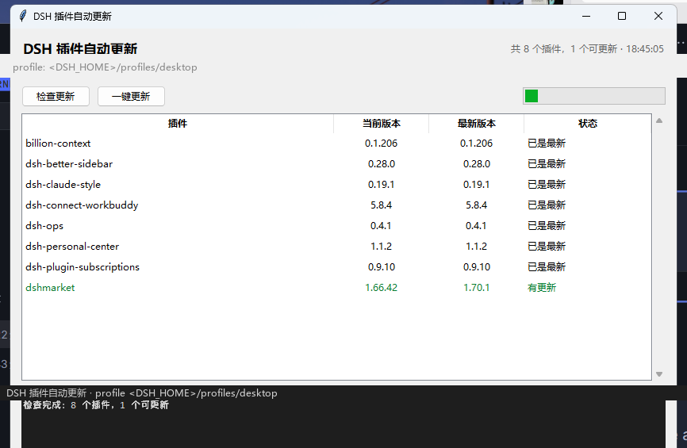

# DSH 插件自动更新

> Check, update and uninstall DeepSeek Harness plugins — one small, dependency-free Windows GUI.

一个零依赖的 Windows 小工具：列出 DeepSeek Harness 桌面 profile 里装的所有第三方插件，对比 npm 上的最新版本，一键更新，或选中单个插件后确认卸载。



*早期界面截图；当前版本另有「卸载选中插件」按钮。*

> 非官方工具，与 DeepSeek 官方无关。

## 为什么用它

插件多了以后想知道哪个该升级，就得逐个 `npm view`。这个工具把检查、更新和卸载放在一个窗口里，更新仍走 **DSH 官方安装链路**（`dsh plugin --profile <profile> add`），卸载调用官方 `remove`，不自己删包或改写 bundles。

## 系统要求

- Windows 10/11
- Python 3.8+（用系统自带的 tkinter，无第三方依赖）
- 已安装 DeepSeek Harness 桌面版

## 用法

双击 `dsh-plugin-updater.pyw` 即可（`.pyw` 不会弹黑框）。也可以：

```bat
pythonw dsh-plugin-updater.pyw          :: 打开界面
python  dsh-plugin-updater.pyw --check   :: 只检查并打印，适合计划任务
python  dsh-plugin-updater.pyw --update  :: 直接更新所有可更新项
```

更新后需要重启 DeepSeek Harness 才生效。

更新结束会刷新本地版本，并区分「完成」「版本已更新，安装未完成」「更新失败」。命令报错但目标版本已落盘时，不会误报完成；`--update` 对未完成或失败仍返回非零状态。若提示 `ERR_PNPM_IGNORED_BUILDS`，表示依赖安装脚本被安全机制拦截：核对脚本并备份配置后，仅批准必要的包版本、补跑构建，再验证相关功能。工具不会自动批准脚本或关闭安全检查；重新「检查更新」只比较版本，不代表安装问题已修复。

### 卸载插件

1. 保存任务并完全退出 DSH，再单独打开本工具；不要同时运行其他插件管理器。
2. 选中插件，点「卸载选中插件」，核对包名、版本和来源，确认后才执行。默认选择取消。
3. 完成后列表自动刷新，再启动 DSH。检查、更新或卸载进行中不能重复操作或关闭本工具。

- `@deepseek-ai/*` 官方宿主包不会列出，也不能卸载。
- 来自 `github:` / `file:` / `link:` 的第三方依赖虽然跳过更新检查，仍可卸载。
- 卸载前将现有的 `package.json`、锁文件、workspace 和 profile patch 备份到 `<DSH_HOME>/backups/plugin-updater/uninstall-*`，路径会写入窗口日志。**这不是完整回滚备份**：不含插件代码和数据，不能只复制清单就当作恢复；重新安装仍需原来源可用。
- 不主动清理账号、聊天或插件数据，不自动修复自定义配置引用。其他插件若依赖被卸载的包，可能无法启动，确认前请自行核对。
- 官方命令失败也可能已部分修改 profile；请查看错误和备份，不要盲目反复重试。

## 配置

| 环境变量 | 默认值 | 说明 |
| --- | --- | --- |
| `DSH_UPDATER_PROFILE` | `desktop` | 要检查的 profile 名 |
| `DSH_UPDATER_REGISTRY` | `https://registry.npmjs.org` | npm registry，换镜像时用 |
| `DSH_HOME` | 自动探测 | DSH 数据目录；探测顺序见 `dsh_home()`，会显式传给官方命令，保证操作与列表指向相同目录 |
| `DSH_UPDATER_DSH` | 自动探测 | `dsh.cmd` 完整路径；默认查 PATH、标准安装位置与 Windows 安装登记。填错会报错，不静默换用其他 CLI |

## 工作原理

1. 读 `<DSH_HOME>/profiles/<profile>/package.json` 的 `dependencies`。
2. 并发查 `registry/<pkg>/latest`，按 semver 比较（含预发布版）。
3. 更新时串行执行 `dsh plugin --profile <profile> add [-w] <pkg>@<ver>`；profile 里有 `pnpm-workspace.yaml` 时才加 `-w`。
4. 卸载前校验包名、profile 名和当前直接依赖来源，再备份配置；执行 `dsh plugin --profile <profile> remove [-w] <pkg>`，成功后复查依赖已移除。官方 CLI 负责同步 bundles；工具不处理运行中的插件，因此卸载前必须退出 DSH。

## 已知限制

- 只支持 Windows（界面用 tkinter，安装命令走 `cmd /c`）。
- 只更新来自 npm 的插件。写成 `github:` / `file:` / `link:` 的依赖会显示「跳过」，因为查 registry 的 latest 对它们没意义。
- 本地版本高于 registry 时显示「本地更新（预览版）」，不会被降级。
- 更新的是 **latest 正式版**，不跟进预发布通道。
- `@deepseek-ai/*` 宿主包直接跳过——它们随 DSH 本体升级，不在 npm 主线跟随。
- 界面只有中文。

## 测试

```bat
python -m unittest -v test_updater.py
```

## 许可证

[MIT](LICENSE)
